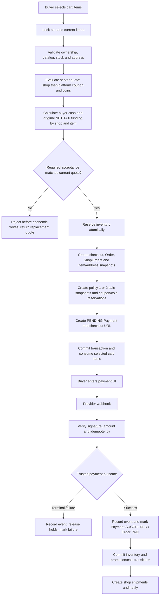

# Checkout Flow



`CheckoutQuoteEvaluator` supplies preview and commitment calculations. Commitment
revalidates inside the cart transaction; preview does not guarantee the same price
later. Failed commitment rolls back its writes.

Rules:

- Checkout locks the cart and its current item rows before reading the purchase snapshot. Concurrent submissions reread after the prior commit, so consumed items cannot create another Order. Unselected items and later additions remain usable.
- The UI blocks immediate repeated submission and allows retry after failure. After a lost committed response, order history recovers the Order; retry does not promise replaying the original response.
- Stock reservations compare on-hand and reserved quantities in the same SQL update. Seller changes lock inventory and cannot reduce on-hand below active reservations. Expiry releases abandoned holds.
- Flash quota includes committed sales and every ACTIVE hold, including holds past their expiry timestamp. Quota is returned only by an explicit RELEASED or EXPIRED transition. A trusted late payment can commit a still-ACTIVE hold; worker delay must not make the same quota available to another checkout.
- The browser never marks payment successful. Zero-cash Orders retain the trusted payment lifecycle.
- The current webhook body contains amount but no currency. Settlement uses stored purchase currency; this does not verify a provider callback's currency. A real provider integration must verify signed currency as well as amount before settlement.
- `Payment.amount = Order.grandTotal = subtotal - discountTotal + shippingTotal + taxTotal`. `taxTotal` is added tax; included tax is disclosed without adding it again. `includedTaxTotal` and `reportedTaxTotal` are retained on Checkout, Order and ShopOrder.
- Prices, address, original quantities, funding components, tax policy/revision and original commission are retained at purchase. Later settings do not rewrite them.
- Seller shipping fees are decimal baht inputs, parsed exactly to bounded minor units, and applied once per selected Shop.
- Database money remains bigint. HTTP money is canonical integer text, inferred through Eden; operational provider amounts remain checked safe integers. See [money design](numeric-money-design.md).

## Quote acceptance and version selection

`shopCouponCode` and `platformCouponCode` are named slots. The Shop coupon applies
first; the platform coupon uses the remaining merchandise base; coins follow.
Outcomes are returned in provided slot order. Invalid scope, duplicate named code
or an unusable committed coupon is rejected. Estimates can show an unapplied
coupon. Legacy `couponCode` still accepts one coupon, but cannot be combined with
named slots.

A nonzero tax policy or a provided named coupon slot selects settlement policy 2.
Zero-tax checkout without named slots retains policy 1, including the legacy
single-coupon input. Policy 2 requires both `acceptedQuoteFingerprint` and
`acceptedTaxPolicyRevision` from the displayed quote. A changed price, policy or
other accepted quote fact yields `409 QUOTE_CHANGED` with a replacement quote
before stock, coupon, coin, Order or Payment commitments. Provided acceptance
fields are checked for policy 1 too.

Policy 2 admission requires `CHECKOUT_V2_SETTLEMENT_ENABLED=true`, captured at
service construction. Change the flag and replace every API instance; an old
enabled instance remains enabled until replacement. Admin tax-policy GET/PUT
reports that instance's captured capability. A disabled instance rejects new v2
with `503 TAX_SETTLEMENT_UNAVAILABLE`, including named slots at zero tax, while
existing v2 Orders continue through original settlement processors. With a stored
nonzero policy, disabling the flag deliberately blocks checkout rather than
silently changing the policy. Never roll code back before v2 support after v2
sales exist.

## Purchased settlement facts

[ADR-0005](adr/0005-discount-funding-and-refundable-commission.md) separates buyer
cash from seller entitlement. Shop coupons reduce seller rights; marketplace
coupons and coins preserve those rights through platform funding. Deterministic
integer allocations use stable cart-item keys through Order Item creation.

`ItemSaleSnapshot` retains original quantity, advertised gross, Shop discount,
platform/coin funding and buyer cash, plus both named coupon identities. Policy 2
also freezes buyer, platform coupon and coin NET/TAX pools and original buyer NET
cashback/affiliate bases. `ShopSaleSnapshot` freezes policy version, currency,
original commission base/rate/fee, shipping components and recognition marker;
policy 2 adds complete tax configuration/revision, gross seller receipts and
shipping NET/TAX. Missing or inconsistent original facts fail closed.

For zero-tax policy 1:

```text
seller merchandise rights = advertised merchandise - Shop coupon
buyer merchandise cash = seller merchandise rights - platform coupon - coins
original shipping = buyer shipping + Shop waiver + platform shipping subsidy
seller shipping rights = buyer shipping + platform shipping subsidy
```

For policy 2, seller gross receipts include the frozen tax components, while
commission uses the sum of merchandise NET pools, excluding all shipping and tax.
The original fee is `floor(commissionBase * commissionBps / 10000)`. Earnings use
gross surviving seller rights minus that original fee, not the NET commission
base as a substitute for seller receipts.

Tax defaults to zero. Admin-only `GET/PUT /api/admin/checkout/tax-policy` stores
`checkout.tax` and rotates its revision. Nonzero configuration must explicitly
choose inclusive/exclusive mode, rate in ppm, `BUYER_AFTER_ALL_DISCOUNTS` or
`SELLER_AFTER_SHOP_COUPON` funding basis, taxable shipping, shipping after waiver,
`LINE_HALF_UP`, `SELLER` custody and `BUYER` exclusive-tax funding. Unsupported
modes/custodians are rejected. Each extended item line and Shop shipping charge
rounds half up in minor units. A configured or example rate is not a legal-rate
decision. See [tax design](numeric-tax-design.md).

Shop free shipping waives Shop entitlement; marketplace free shipping preserves
it through subsidy. Checkout stores these facts atomically with the Order and
does not credit a withdrawable wallet at payment success. Recognition and refunds
follow [fulfillment-flow.md](fulfillment-flow.md). Pre-snapshot Orders retain the
validated legacy path; policy 1 snapshots remain supported without being upgraded
to today's policy.
