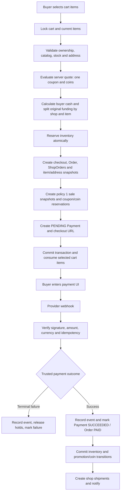

# Checkout Flow



`CheckoutQuoteEvaluator` supplies both preview and commitment calculations. The
commitment revalidates inside the cart transaction; a preview does not guarantee
the same price later. Failed commitment rolls back its partial writes.

Rules:

- Checkout locks the cart and its current item rows before reading the purchase snapshot. Concurrent submissions re-read after the prior commit, so consumed items cannot create another Order. Unselected items and later additions remain usable.
- The UI blocks immediate repeated submission and allows retry after failure. After a lost committed response, order history recovers the Order; retry does not promise replaying the original response.
- Stock reservations compare on-hand and reserved quantities in the same SQL update. Seller changes lock inventory and cannot reduce on-hand below active reservations. Expiry releases abandoned holds.
- The browser never marks payment successful. Zero-cash Orders retain the existing trusted payment lifecycle; this increment adds no separate browser-controlled success or provider bypass.
- Payment.amount equals Order.grandTotal. Tax is currently zero; policy 1 snapshot creation rejects nonzero tax.
- Prices, address, original quantities, and settlement components are retained at purchase. Later coupon, shipping fee, or commission changes do not rewrite them.
- Seller shipping fees are entered in baht, stored in minor units, and applied once per selected Shop.

## Purchased settlement facts

[ADR-0005](adr/0005-discount-funding-and-refundable-commission.md) separates buyer
cash from seller entitlement. Checkout still accepts **one coupon plus coins**.
A Shop coupon records seller funding; a marketplace coupon and coins record
marketplace funding. Deterministic integer allocation preserves the quote totals
across shops and items.

`ItemSaleSnapshot` records original quantity, gross merchandise, seller coupon
discount, platform coupon discount, coin discount, buyer merchandise cash, and
coupon identity text. For each item:

```text
seller merchandise rights = gross merchandise - seller coupon discount
buyer merchandise cash = seller merchandise rights - platform coupon discount - coin discount
```

`ShopSaleSnapshot` records policyVersion 1, currency, commission base/rate/original
fee, original shipping, buyer shipping, Shop waiver, and marketplace shipping
subsidy. The fee is the floor of original merchandise rights × bps / 10,000,
calculated with integer intermediates. Shipping and tax are outside its base.

```text
original shipping = buyer shipping + seller shipping waiver + platform shipping subsidy
seller shipping rights = buyer shipping + platform shipping subsidy
```

Shop free shipping waives Shop entitlement; marketplace free shipping preserves
it through the subsidy. Checkout stores these facts atomically with the Order.
It does not credit a withdrawable wallet balance at payment success. Earnings
recognition and component refunds follow [fulfillment-flow.md](fulfillment-flow.md).
Orders created before these snapshots continue through the explicit legacy path.
