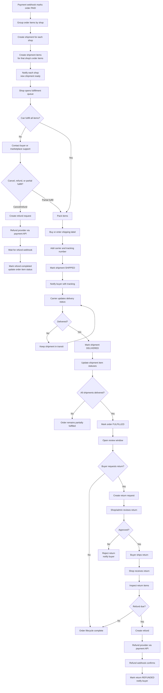

# Fulfillment Flow

Rules:
- Shipments are split by `shopId`; a multi-vendor order has multiple shop-owned shipments.
- Shipment items allocate quantities from order items, allowing partial fulfillment.
- Packing, shipping, and delivery lock the parent order before changing shipment state, serializing concurrent updates from different shops. After shipping or delivery, the parent is `DELIVERED` when every shipment is delivered, `SHIPPED` when every shipment is shipped or delivered, and `PARTIALLY_FULFILLED` otherwise.
- Refund completion should follow payment provider confirmation, preferably webhook-backed.
- Return approvals and refund amounts are separate decisions from shipment delivery.
- Item refunds use the shop-order subtotal minus its snapshotted coupon/coin discounts. Discounts are allocated across that shop's items in stable ID order, retaining every minor unit; item refunds exclude shipping charges.
- Both admin refund endpoints (`/status` and the legacy `/process`) use the same approval policy: record the processing administrator, then require a different completing administrator and an external refund reference. Legacy processing records without an administrator must be marked processing again before completion.
- Refund completion locks the order, checks the remaining paid amount, and atomically records seller wallet debits and buyer coin adjustments. Retrying completion does not debit again. A return debits its shop; an order-wide refund is allocated across shop-order totals.
