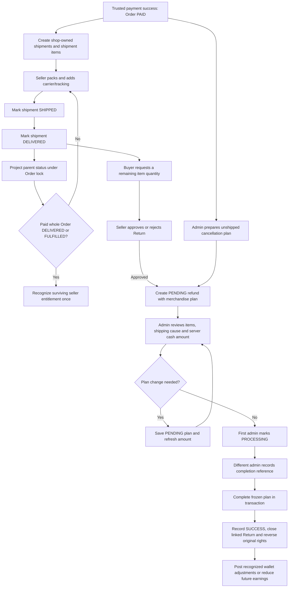

# Fulfillment Flow

## Shipment and earnings

- Shipments are split by Shop. Shipment items allocate Order Item quantities and support partial fulfillment.
- Packing, shipping, and delivery lock the parent Order before changing state. Canceled shipments are excluded from active delivery projection. The parent becomes DELIVERED when every remaining shipment is delivered, SHIPPED when every remaining shipment is shipped or delivered, and PARTIALLY_FULFILLED otherwise. An all-canceled shipment set projects CANCELED; refund completion applies its separate full-cancellation REFUNDED transition.
- A paid Order in DELIVERED or FULFILLED state qualifies for earnings recognition. Eligibility remains whole-Order based; this increment does not release earnings independently per Shop.
- Policy 1 and 2 recognition use original sale snapshots, surviving seller gross merchandise and shipping rights, and the remaining original fee. Policy 2 includes frozen tax in seller receipts and excludes tax from the commission base. Successful refunds before recognition reduce future credit instead of debiting unearned funds. Current policy, commission settings and the v2 admission flag do not rewrite original rights.
- Recognition locks the Order and Shop wallets in Shop ID order. `recognizedAt` makes repeated recognition a no-op, including a fully reversed sale whose surviving credit is zero.

## Refund planning and approval

[ADR-0005](adr/0005-discount-funding-and-refundable-commission.md) and the
[tax/partial-return contract](numeric-tax-design.md) govern snapshotted sales.
`RefundItemAllocation` records quantity, `successfulQuantityBefore` and separate
original buyer cash NET/TAX, platform coupon NET/TAX and coin NET/TAX reversals.
`RefundShopAllocation` records shipping cause and NET/TAX reversals, original
commission reversal and wallet posting.

Policy 1 and 2 support positive integer quantities up to the remaining original
quantity. A quantity interval starts at the cumulative SUCCESS quantity. Each
atomic component uses `floor(original*(q+k)/Q) - floor(original*q/Q)`, with NET and
TAX rounded separately. For original NET 94 / TAX 7 / quantity 3, sequential cash refunds are
33, 33 and 35 minor units. Full cumulative return exhausts the original pools.

One PENDING/PROCESSING refund may hold an Order Item at a time, alongside its
originating active Return. Another active Return or competing plan for that item
is rejected; different items can hold plans concurrently. SUCCESS consumes rights;
confirmed FAILED releases its held interval. Shipping capacity is also reserved
by active plans. Malformed or partially snapshotted rights produce HTTP 409.
No-snapshot legacy Orders do not gain partial-quantity rights from current policy.

Buyer Return quantity is optional for legacy callers and defaults to all remaining
rights; explicit quantity must be a positive Int32 within the server projection.
Buyer Order items expose `remainingReturnQuantity` and `hasActiveReturn`.
Create/cancel/approve/reject lock Order first and reread Return/settlement state.

Approval creates a PENDING merchandise plan atomically. It does not establish
physical receipt or complete the refund. Free-text reasons do not authorize
seller-fault shipping. Refund SUCCESS atomically advances an APPROVED/RECEIVED
linked Return to COMPLETED; confirmed FAILED advances it to CANCELLED, allowing
a new request for the released quantity. COMPLETED is terminal, and fulfillment
returns do not automatically restock physical goods.

Admins can create a PENDING cancellation using
`POST /api/admin/orders/:orderId/refunds` and update a PENDING plan using
`PATCH /api/admin/refunds/:refundId/plan`. The UI saves changes, refreshes the
server amount, and requires a separate processing action. A Return-linked plan
must preserve the approved item IDs/quantities and its Shop. Its UI quantities
are read-only; a direct admin plan can edit quantities within remaining rights.
Shipping cause can still be reviewed independently.

| Shipping cause | Buyer-paid shipping | Marketplace subsidy | Required scope/evidence |
|---|---|---|---|
| NONE / CHANGE_OF_MIND | Retained | Retained | No shipping reversal |
| PRE_SHIPMENT_CANCEL | Refund remaining original amount | Reverse unused subsidy | Full original quantities of every Shop Order item, no prior partial interval; no shipment sent or delivered |
| SELLER_FAULT | Refund remaining original amount once | Retained for incurred carrier obligation | Authorized admin decision and shipped/delivered evidence |

Completion rechecks shipping evidence. A pre-shipment cancellation restores the
paid committed stock once and cancels affected items, Shop Orders, and shipments.
When all Shop Orders are canceled, Order and successful Payment statuses become
REFUNDED. Other merchandise returns do not imply this cancellation transition.

Both admin status endpoints use two-person completion: the first administrator
records PROCESSING, and a different administrator completes with a nonempty
reference. For positive cash, the reference records an external refund; for zero
cash, it records internal settlement through the same `externalReference` field.
The current path records manual completion; it does not call a refund provider or
verify a refund webhook. A reference alone is not proof of a bank/provider transfer.

## Component completion and debt

Completion locks Order, validates successful payment and remaining cash, and
rechecks frozen item/shipping capacity against other active plans. Original
commission reversal uses the purchased fee and cumulative successfully reversed
merchandise NET rights, bounded by that original fee. Full merchandise return
reverses the entire fee, even when shipping is retained.

If earnings were already recognized, seller entitlement debits and fee credits
are posted under sorted ShopWallet locks. Otherwise the successful allocations
reduce future recognition. `walletPostedAt` prevents a second posting. Buyer coin
restoration follows original coin funding NET plus TAX, preserving the original
spent-coins identity. Cashback reversal uses original buyer merchandise NET,
excluding tax and all shipping. Affiliate reversal uses immutable original item
NET bases and cumulative original award amounts, with one refund-linked reversal;
missing legacy award evidence fails closed. No replacement coupon or goodwill
is awarded automatically. Order, inventory, Return, allocation, wallet, coin and
affiliate writes roll back together on completion failure.
Replaying SUCCESS does not apply these adjustments again.

For snapshot orders with coin funding, restoration requires original SPENT evidence
matching the saved funding and the buyer's wallet. Missing, insufficient,
over-restored or unrelated-wallet history rejects with 409 and rolls back the
entire completion instead of silently reducing the promised coin restoration.

After pre-shipment cancellation commits, first completion and SUCCESS replay
invalidate affected product detail and seller dashboards plus shared discovery,
search and recommendation caches. Sold-count projections exclude canceled lines
under a still-successful multi-shop payment. Delivered returns retain their
historical sale counts. The actual PostgreSQL/Redis regression covers refresh and
idempotent retry; cache failure continues to use the existing fail-open policy.

Seller debt is the negative economic ledger after adding back reversible active
payout reservations. The signed available balance remains visible separately.
Future earnings repay debt before withdrawal. Payout approval and marking paid
lock the payout and wallet, match currency, and reject a negative available ledger
balance; rejection can still release a hold. This gate cannot undo a bank transfer
already made externally.

Orders with no snapshots retain the validated legacy cash allocation described
in [refund-allocation-design.md](refund-allocation-design.md); they do not acquire
today's funding or fee policy. Historical inconsistencies require reconciliation.
